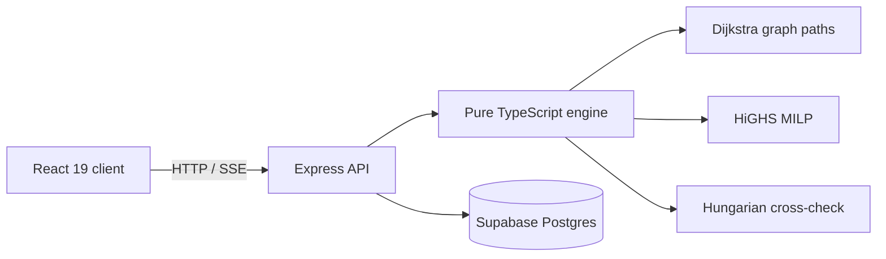
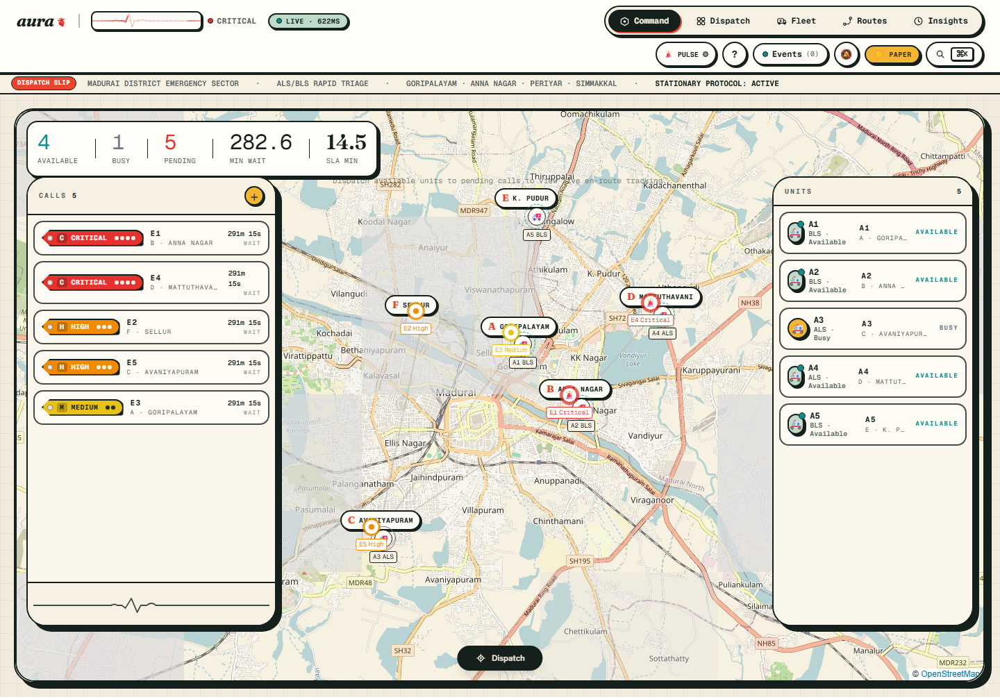
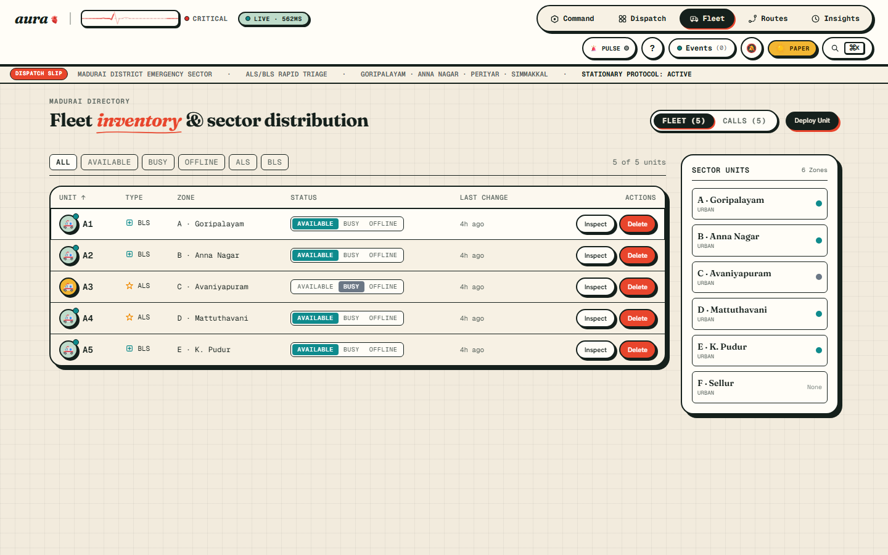
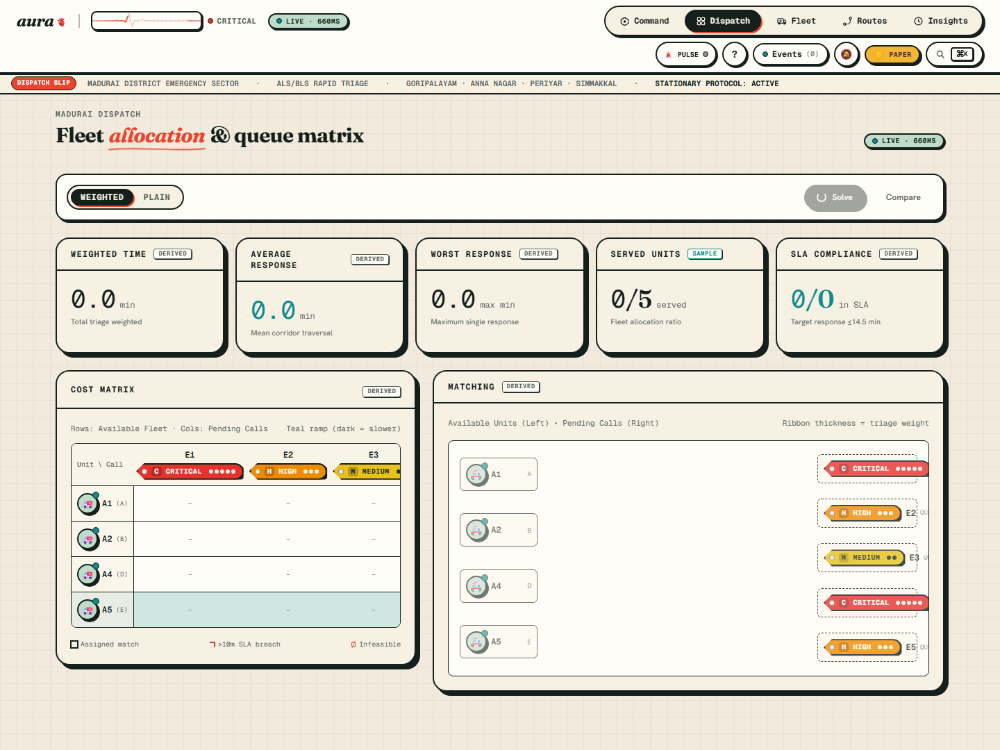
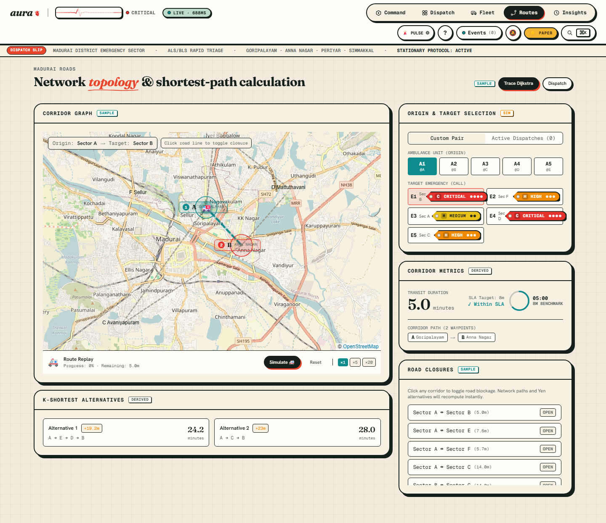
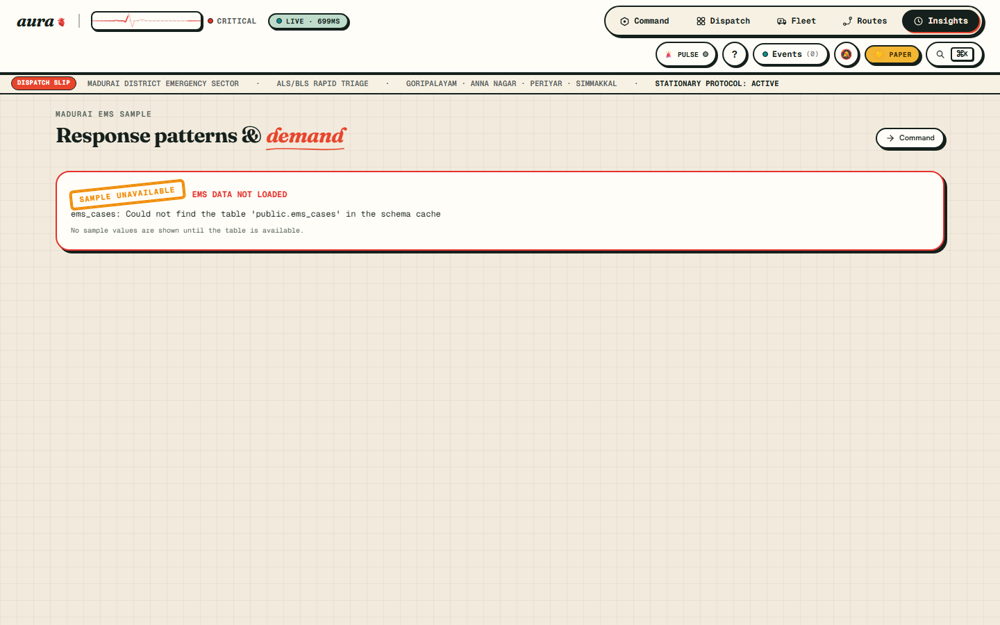

# aura

AURA is a responsive ambulance dispatch console for Madurai. It presents the current fleet and pending calls, computes assignments from the live road graph, compares the optimizer with dispatcher baselines, traces routes, and evaluates seeded scenarios. The client is React 19 and Vite; an Express API owns the engine boundary and reads/writes Supabase when configured. With no Supabase settings, a clearly labelled local SIM state is used.

## Architecture



The engine in `engine/` has no I/O or UI imports. Express is started by `server.ts`; the client data source is in `src/data/`.

## Assignment Model

For unit $i$ and call $j$, the travel estimate is the graph shortest path plus the mean local-zone delay. Same-zone responses use that zone's local delay; unreachable pairs are infeasible.

$$
t_{ij}=\begin{cases}
	ext{localMin}_i & z_i=z_j \\
	ext{shortestPath}(z_i,z_j)+\dfrac{\text{localMin}_i+\text{localMin}_j}{2} & z_i\ne z_j
\end{cases}
$$

Binary $x_{ij}$ assigns unit $i$ to call $j$ and binary $u_j$ leaves call $j$ unserved. A feasible assignment cost includes any configured ALS policy penalty. The queue cost uses `unserved_min`.

$$
\min \sum_{i,j} w_j(t_{ij}+p_{ij})x_{ij}+\sum_j w_jQ u_j
$$

$$
\sum_i x_{ij}+u_j=1\quad\forall j,\qquad
\sum_j x_{ij}\le1\quad\forall i,\qquad
x_{ij},u_j\in\{0,1\}.
$$

Weighted mode uses the generated triage weights Critical 5, High 3, Medium 2, Low 1. Plain mode uses weight 1. Hard ALS policy removes incompatible pairs; penalty policy prices the mismatch; off policy ignores ALS capability. Response caps and unreachable routes are infeasible. HiGHS and the Hungarian cross-check are compared within $10^{-6}$.

## Data Provenance

| Data | Provenance | Use and label |
| --- | --- | --- |
| `data/ambulances.csv`, `data/emergencies.csv` | Provided SAMPLE files | Starter records only; not the solver's runtime source. |
| `data/travel_times.csv` | Provided SAMPLE fixture | Legacy matrix for inspection only; the engine does not read it. Runtime travel is derived from `road_edges`. |
| `data/tamil_nadu_ambulance_data.xlsx` | Provided SAMPLE workbook; sheet `dummy_ambulance_data` | Input workbook with case, triage, timing, and response fields. It is not displayed as a live operational feed. |
| Supabase operational tables | Current configured database state | Fleet, calls, roads, zones, dispatches, and settings. The open demo RLS policy currently permits writes with the anon key. |
| `ems_cases` | SAMPLE cohort, $n=50$ per project data contract | Insights uses the Supabase sample when available and otherwise reads the 50-row provided workbook. The source is labelled; sample rows are not presented as live operational data. |
| Shortest paths, travel matrix, objective, assignments, metrics | DERIVED | Computed by `engine/graph.ts` and `engine/assignment.ts` from current inputs. |
| Monte Carlo evaluation | SIM | Generated from the displayed seed and scenario count; it is not an observed operational outcome. |

## Screens

| Screen | What it shows | Screenshot |
| --- | --- | --- |
| Command | Live fleet/call map and dispatch activity |  |
| Fleet | Unit status and emergency registry |  |
| Dispatch | Cost matrix, assignments, baselines and Solver model |  |
| Routes | Road network and Dijkstra trace |  |
| Insights | SAMPLE EMS patterns and SIM evaluation |  |

Each screen also has Paper/Night captures at desktop, tablet, and 390px in [`docs/screenshots/`](docs/screenshots/).

## Assumptions And Limits

- Road-edge travel minutes are static estimates, not traffic-aware GPS predictions.
- Local response/approach time is represented by `localMin`; service duration is a single configurable `service_min`.
- The optimizer assigns at most one call per unit per solve. It does not solve a rolling multi-call schedule with service-time sequencing.
- Route blocking and dispatch lifecycle are reflected by the current graph and database transitions; the database triggers remain authoritative for persisted state.
- The demo Supabase RLS policy lets anyone holding the public anon key write operational tables. The security next step is Supabase Auth with role-based policies and restricted writes.
- The provided guide PDF/PPT was not present in this repository, so report and slide titles have not been verified against it.
- If the configured PostgREST schema does not expose `ems_cases`, Insights uses the provided 50-row workbook sample and labels that source instead of presenting it as live data.

## Run Locally

Prerequisites: Node.js 22 or newer and npm. Copy `.env.example` to `.env`, then fill the deployment settings you have. Never commit `.env` or publish the anon key outside its intended public-client role.

```powershell
npm ci
npm run dev
```

Open `http://localhost:3000`. The server hosts the Vite client and `/api` routes. With Supabase configured, it reads the connected project. Without those values, the app uses its explicit local SIM state.

Production build and start:

```powershell
npm run lint
npm test
npm run build
npm start
```

`npm start` serves the already-built `dist/` bundle. Set `NODE_ENV=production` in the hosting environment.

## Tests And Fixture Regeneration

```powershell
npm test
npm run test:coverage
npm run screenshots
npm run parity:export
python -m pip install -r python/requirements.txt
python python/pulp_reference.py
```

`parity:export` deterministically writes `tests/fixtures/parity.json`. The Python reference writes the independently computed expected objectives. The TypeScript tests separately check the production HiGHS/Hungarian cross-check and open the generated Excel workbook with ExcelJS. Python/PuLP parity must be run in an environment with Python installed.

## Deployment

Render configuration is in [`render.yaml`](render.yaml). Set the hosting environment variables listed in [`.env.example`](.env.example); the Render health check is `/api/health`. Railway can use the same build/start commands.

## Further Reading

- [Screenshots](docs/screenshots/)
